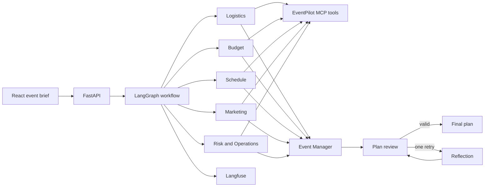

# EventPilot Architecture

## Agent Roles

- Logistics selects venue options and capacity guidance.
- Budget validates proposed spend against the approved limit.
- Schedule checks 12-hour agenda conflicts.
- Marketing creates approval-gated communication readiness steps.
- Risk and Operations creates an initial mitigation register.
- Event Manager synthesizes a structured final plan from specialist context.
- Review validates budget arithmetic and agenda formatting, then permits one reflection retry.

## Design Trade-offs

The internal MCP server uses deterministic, read-only catalog data for reliable demonstrations. External Maps, Calendar, and email integrations are deferred until credentials and human approval controls are available. Independent specialist nodes run in parallel to reduce latency. SQLite persists the latest event and plan locally; it is suitable for a course project rather than concurrent production use.
